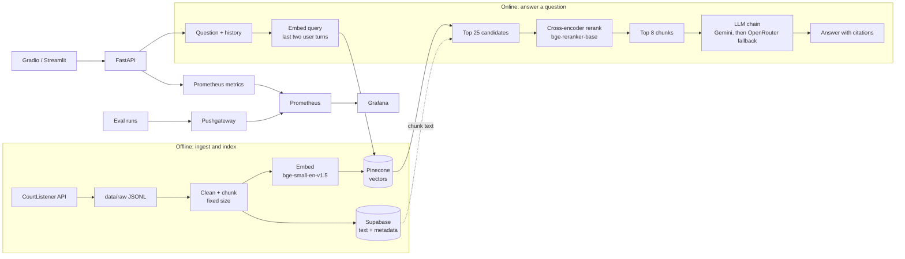

# BenchBrief

**Decision support for judges: a case summary, cited precedent, and the reasoning paths that precedent supports. Never a verdict.**

BenchBrief is a retrieval-augmented generation (RAG) system over federal opinions from the U.S. District Court for the Northern District of California (sourced from [CourtListener](https://www.courtlistener.com/)). A judge pastes a case or asks a follow-up question; the system retrieves relevant passages from the corpus, answers **only** from those passages, and cites each claim. It is a research aid, **not legal advice**.

> **Status:** working end to end on a deliberately small corpus (12 opinions, 243 chunks). The focus of the project is the engineering around retrieval, grounding and *measurement*, not corpus size. See [Limitations](#limitations).

---

## What it does

| Mode | Input | Output |
|---|---|---|
| **Analyze a case** (`POST /analyze`) | Text of a pending case | Case brief + reasoning paths for the judge's consideration, with the precedent passages used |
| **Ask a question** (`POST /chat`) | A question (with chat history) | A direct answer from retrieved sources only, with citations like `[Opinion 123, source 2]` |

Design rules baked into the prompts:
- Answer only from the numbered sources; if they do not contain the answer, say so.
- Cite every claim; name any authority a source itself cites (case, court, year).
- Quote legal standards exactly; keep separate holdings separate.
- **Never say how the judge should rule**: lay out competing considerations and leave the decision to the judge.

## Architecture



Optional hybrid search (off by default): BM25 keyword search fused with the dense results using Reciprocal Rank Fusion (`USE_BM25=1`).

## Tech stack

- **Retrieval:** `BAAI/bge-small-en-v1.5` embeddings (384-d), Pinecone, Supabase (Postgres), `BAAI/bge-reranker-base` cross-encoder, own BM25 + RRF implementation
- **Generation:** OpenAI-compatible provider adapter (Gemini, OpenRouter, Ollama, vLLM) with retries, backoff, daily-quota fail-fast and a fallback chain
- **Serving:** FastAPI, Gradio (single-process demo), Streamlit
- **Observability:** Prometheus, Grafana, Pushgateway (docker-compose)
- **Evaluation:** custom retrieval eval with a paired significance test, RAGAS (faithfulness, factual correctness) via a custom judge adapter

## Repository layout

```
ingestion/      CourtListener fetcher (dockets, clusters, opinions)
data/           raw/ (JSONL from CourtListener) and processed/ (chunks)
db/             Supabase schema and loader
indexing/       chunking strategies, embeddings, Pinecone upsert
retrieval/      dense search, cross-encoder rerank, BM25 + fusion
generation/     case-brief pipeline, cited chat, prompts
utils/          LLM adapter (retry, fallback), JSONL and text helpers
api/            FastAPI service
observability/  Prometheus metrics, structured logging
grafana/        docker-compose for Prometheus, Pushgateway, Grafana
evaluation/     golden-set builder, retrieval eval, RAGAS eval, datasets
app.py          single-process Gradio + API app (used for the hosted demo)
chat_app.py     Streamlit chat UI
scripts/        git_push_by_module.sh, build_space.sh
PROJECT_LOG.md  decisions, bugs, free-tier lessons, open items
```

## Quickstart

Requires Python 3.12.

```bash
python3 -m venv .venv && source .venv/bin/activate
pip install -r requirements.txt

cp .env.example .env      # fill in your real values first (never commit .env)
set -a; source .env; set +a
```

You need: a Supabase project (run `db/schema.sql` in its SQL editor), a Pinecone account (the `benchbrief` index, 384-d cosine, is created automatically on first upsert), and at least one LLM key (`GEMINI_API_KEY` and/or `OPENROUTER_API_KEY`).

### 1. Build the data (once)

```bash
python3 -c "from ingestion.fetch_courtlistener import run; run(max_opinions=12)"   # raw JSONL -> data/raw
python3 -c "from indexing.chunk_documents import run; run('fixed_size')"  # -> data/processed
python3 -c "from db.load_data import run; run('fixed_size')"              # -> Supabase
python3 -m indexing.pinecone_client                                       # embed + upsert -> Pinecone
```

The repository already includes the 12-opinion corpus and its chunks, so you only need the last two steps against your own Supabase and Pinecone projects.

### 2. Run it

```bash
uvicorn api.main:app --port 8000     # API + /metrics
streamlit run chat_app.py            # Streamlit UI (talks to the API)
python3 app.py                       # OR: single-process Gradio UI + API on :7860
```

```bash
curl -s localhost:8000/chat -H 'content-type: application/json' -d '{
  "messages": [{"role": "user", "content": "What standard applies to fee-shifting under 28 U.S.C. 1927?"}],
  "top_k": 8
}'

curl -s localhost:8000/analyze -H 'content-type: application/json' -d '{
  "current_case_text": "<paste the case here>", "top_k": 8
}'
```

### 3. Observability (optional)

```bash
cd grafana && docker compose up -d     # Prometheus :9090, Pushgateway :9091, Grafana :3000
export PUSHGATEWAY_URL=http://localhost:9091   # lets eval runs publish their scores
```

The API exposes `benchbrief_requests_total` and `benchbrief_request_latency_seconds` per stage (retrieval, generation, ...). Eval runs push `benchbrief_eval_*` gauges.

## Configuration

| Variable | Purpose | Default |
|---|---|---|
| `GEN_LLM` | Generation chain, e.g. `gemini,openrouter=<model>` (first = primary, rest = fallbacks) | `gemini,openrouter` |
| `USE_RERANK` | Cross-encoder rerank of the top 25 | `1` |
| `USE_BM25` | Fuse BM25 with dense search | `0` |
| `DEMO_LIMIT_PER_HOUR` | Per-visitor request limit in `app.py` | `0` (off) |
| `PUSHGATEWAY_URL` | Where eval runs push metrics | unset (no-op) |
| `LLM_MIN_INTERVAL` | Minimum seconds between LLM calls (free-tier pacing) | provider default |

## Evaluation

**Golden set:** 129 questions over the 12 opinions. One LLM drafts each question from a chunk, a *different* LLM judges it on four criteria (pass only if all are 4 or higher), and a human audits a sample. Every question records the exact chunk(s) that answer it, so retrieval is scored **without any LLM in the loop**. Questions were capped per opinion and sampled round-robin so no single case dominates.

```bash
python3 -m evaluation.retrieval_eval                              # baseline vs rerank
python3 -m evaluation.retrieval_eval baseline hybrid hybrid_rerank  # include BM25 fusion
GEN_LLM=openrouter JUDGE_LLM=gemini python3 -m evaluation.ragas_eval --n 10
```

**Retrieval results (n = 129, k = 5):**

| Metric | Dense only | + Cross-encoder rerank |
|---|---|---|
| hit@1 | 0.496 | **0.643** |
| hit@3 | 0.729 | **0.814** |
| hit@5 | 0.783 | **0.868** |
| MRR | 0.611 | **0.733** |
| Avg. latency per query | 3.5 s | 7.6 s |

Reranking improves ranking quality at roughly twice the latency. Per-question ranks and misses are written to CSV for triage, and a paired McNemar test reports how many questions each change rescued versus broke.

Not yet measured: hybrid (BM25) retrieval and RAGAS scores on real generated answers. The code is written and tested offline; the runs are pending free-tier quota.

## Limitations

- **Small corpus.** 12 opinions from one district; results say little about a full docket.
- **Small eval.** n = 129 gives about ±6 points of uncertainty; treat small differences as noise.
- **Synthetic questions.** LLM-written questions tend to echo the wording of their source chunk, which flatters retrieval (and any keyword method).
- **Prompt-only guardrails.** Citation and no-verdict rules are enforced by instructions, not by a verifier.
- **Not binding authority.** District court opinions are persuasive, not binding, and there is no citator to check whether a case is still good law.
- **Free-tier infrastructure.** LLM quotas shape how often evals can run; a hosted demo sleeps when idle.

## Roadmap

- Run and report hybrid retrieval and RAGAS results; add the Grafana quality panel
- Citation and no-verdict verifier on generated answers
- Multi-chunk, cross-case and unanswerable questions in the golden set
- Larger corpus and a citator signal
- Self-hosted generation (vLLM) as an alternative provider

## Hosted demo

A Gradio build can be published as a Hugging Face Space. `scripts/build_space.sh` assembles the bundle in `space/`; set the secrets (`SUPABASE_URL`, `SUPABASE_KEY`, `PINECONE_API_KEY`, `GEMINI_API_KEY`, `OPENROUTER_API_KEY`) in the Space settings and keep `DEMO_LIMIT_PER_HOUR` low to protect free-tier quota.

## Data and disclaimer

Opinions come from CourtListener (Free Law Project); check their terms for your use. BenchBrief is a research prototype: its output can be wrong or incomplete and must be verified against the cited sources. It is not legal advice and does not predict or recommend outcomes.

## License

Not yet chosen. Add a `LICENSE` file before making the repository public.
